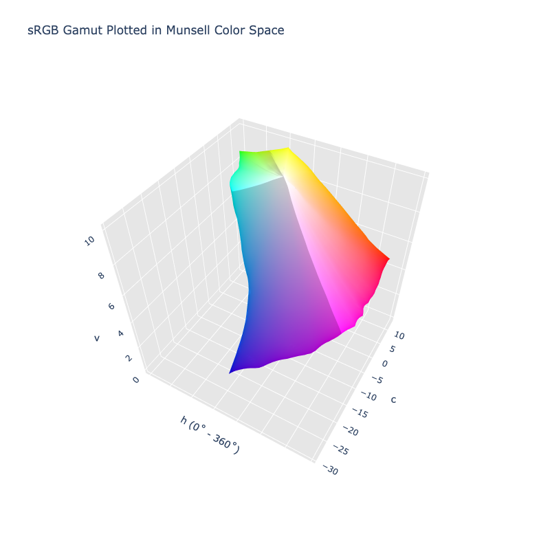

# Munsell

> [!failure] The Munsell color space is not registered in `Color` by default

/// html | div.info-container
> [!info | inline | end] Properties
> **Name:** `munsell`
>
> **White Point:** C / 2˚
>
> **Coordinates:**
>
> Name | Range^\*^
> ---- | -----
> `h`  | [0, 360)
> `v`  | [0, 10]
> `c`  | [0, 35]
>
> ^\*^ Space is not bound to the range and is only used as a reference to define percentage inputs/outputs in
> relation to the Display P3 color space.


//// figure-caption
The sRGB gamut represented within the Munsell color space.
////

The Munsell color system is a color space that specifies colors based on three properties of color: hue (basic color),
value (lightness), and chroma (color intensity). It was created by Albert H. Munsell in the first decade of the 20th
century and adopted by the United States Department of Agriculture (USDA) as the official color system for soil research
in the 1930s.

Munsell determined the spacing of colors along these dimensions by taking measurements of human visual responses. In
each dimension, Munsell colors are as close to perceptually uniform as he could make them, which makes the resulting
shape quite irregular.

```py play
values = [9, 8, 7, 6, 5, 4, 3, 2, 1]
chroma = [0, 2, 4, 6, 8, 10, 12, 14, 16]

def munsell_row(hue, value, chroma_steps):
    """Generate a row with the specified chroma steps for the a specific hue and value."""

    return Steps(
        Color('transparent') if r >= chroma_steps else Color(f'{hue} {value}/{chroma[r]}')
        for r in range(len(chroma))
    )

chroma_steps = [2, 4, 6, 8, 9, 8, 6, 5, 4]
for v, n in zip(values, chroma_steps):
    munsell_row('2.5R', v, n)
```

ColorAide implements the Munsell space as a LCh-like color space with channels for hue, value, and chroma.

-   **Hue**: Munsell Hue as an angle. The 100 step Munsell hue circle is mapped to 360 degrees (3.6 degrees per hue
    step). `0` is `0R` (also called `10RP`) and the hue families progress in this order, each spanning 36 degrees:
   `R, YR, Y, GY, G, BG, B, PB, P, RP`. `5R` is 18 degrees, `10R` (`0YR`) is 36 degrees, `5YR` is 54 degrees, etc.
-   **Value**: Munsell Value. `0` is black and `10` is the perfect reflecting diffuser.
-   **Chroma**: Munsell Chroma. `0` is neutral and there is no theoretical upper limit.

The space is calculated using data from the RIT Munsell Color Science Laboratory
(https://www.rit.edu/science/munsell-color-science-lab-educational-resources) and the ASTM D1535 polynomial for
luminance.

Colors can be specified and displayed in ColorAide's default form using color syntax and with hues in the range 0 - 360.

```py play
color = Color('color(--munsell 270 8 4)')
color.serialize()
```

You can also use a more traditional Munsell notation by setting `notation` to `#!py True`.

```py play
color = Color('2.5R 6/10')
color.serialize(notation=True)
```

> [!tip] Transparency
> It should be noted that the Munsell notation does not support notation for transparency, so it cannot be used in
> inputs and and will be dropped in serialization. To work with transparency, either apply transparency after using a
> Munsell notation for an input and serialize using the default "color" notation. Optionally, you can just work in the
> ColorAide's default "color" notation exclusively as you would with any other color.

```py play
color = Color('2.5R 6/10')
color['alpha'] = 0.5
color.serialize()
```

[Learn more](https://en.wikipedia.org/wiki/Munsell_color_system).
///

## Channel Aliases

Channels | Aliases
-------- | -------
`h`      | `hue`
`v`      | `value`, `lightness`
`c`      | `chroma`

## Input/Output

The Munsell space is not currently supported in the CSS spec, the parsed input and string output formats use
the `#!css-color color()` function format using the custom name `#!css-color --munsell`: or can use Munsell notation:

```css-color
color(--munsell h v c / a)  // Color function
```

Munsell notation is also a supported input:

```
h<hue family> v/c
```

The string representation of the color object and the default string output use the
`#!css-color color(--hct h c t / a)` but the color can be serialized in Munsell notation, omitting transparency as well.

```py play
Color("munsell", [28.105, 5.2406, 20.557], 1)
Color("munsell", [64.077, 7.4175, 13.263], 1).to_string()
Color("munsell", [110.81, 9.694, 12.908], 1).to_string(notation=True)
```

## Registering

```py
from coloraide import Color as Base
from coloraide.spaces.munsell import Munsell

class Color(Base): ...

Color.register(Munsell())
```
